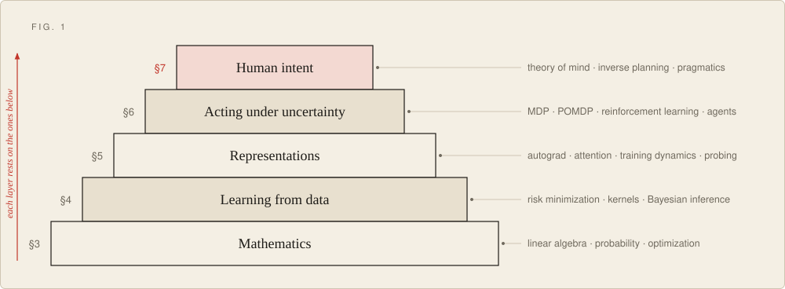
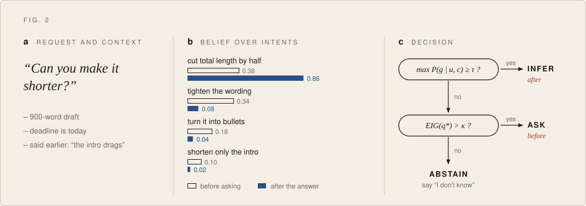
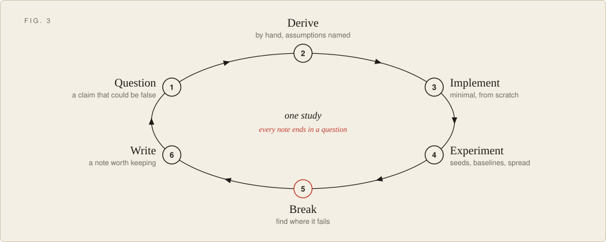

<p align="center">
  <picture>
    <source media="(prefers-color-scheme: dark)" srcset="./assets/banner-dark.svg">
    
  </picture>
</p>

<p align="center">
  <sub>WORKING NOTES &nbsp;·&nbsp; OPENED NOVEMBER 2026 &nbsp;·&nbsp; <a href="https://www.facebook.com/thanhanthinker/">NGUYEN THANH AN</a> &nbsp;·&nbsp; <a href="https://fullstackthinker.com/">FULLSTACKTHINKER.COM</a></sub>
</p>

### Abstract

> This repository is a research notebook on one question: **can a model learn what a person means, and know when to infer, when to ask, and when to say it does not know?** The question is approached from the ground up. Mathematics supplies the language of uncertainty (§3). Classical and deep learning supply systems understood down to the gradient (§4, §5). Decision theory supplies an account of acting under partial information (§6). Cognitive psychology and pragmatics supply a model of how people turn goals into words and actions, which the lab then runs in reverse (§7). Every method is derived by hand, implemented from scratch, and tested until it breaks. The repository is new, so the sections below state the programme and its planned studies, and no result is claimed yet.

**Contents** &nbsp; [1 The question](#1-the-question) · [2 Programme](#2-programme) · [3 Mathematics](#3-mathematics) · [4 Learning from data](#4-learning-from-data) · [5 Representations](#5-representations) · [6 Acting under uncertainty](#6-acting-under-uncertainty) · [7 Human intent](#7-human-intent) · [8 Method](#8-method) · [9 Ethics](#9-ethics) · [10 Status](#10-status) · [Notation](#notation) · [References](#references)

<p align="center"></p>

## 1. The question

Words underdetermine meaning. "Can you make it shorter?" may be about length, wording, format, or a single paragraph, and the speaker usually knows which. A system that maps the sentence to its most likely continuation answers a different question from the one that was asked.

The lab treats what a person means as a **latent variable**: something to hold a calibrated belief about, to update on evidence, and to be corrected on. Three commitments follow from that and apply to every section.

1. **Derive before you import.** A method is worked by hand and checked numerically before a library version is trusted.
2. **Small enough to inspect.** Experiments are sized so that every number can be traced to a cause.
3. **Negative results stay.** A failed experiment with a clear explanation is a kept result.

My [profile](https://github.com/thanhanDemon2003) shows what I build. This repository is where I work out why it works.

## 2. Programme

<p align="center">
  <picture>
    <source media="(prefers-color-scheme: dark)" srcset="./assets/research-map-dark.svg">
    
  </picture>
</p>
<p align="center"><sub><b>Figure 1.</b> The programme as strata. Each section depends on the ones beneath it; §7 is where the lab is headed.</sub></p>

| § | Stratum | Question it answers | Planned studies |
| --- | --- | --- | --- |
| 3 | Mathematics | Why does this work, and when does it stop working? | 3.1 – 3.3 |
| 4 | Learning from data | What can be learned from finite data, and how sure can we be? | 4.1 – 4.3 |
| 5 | Representations | What do networks encode, and how does training put it there? | 5.1 – 5.4 |
| 6 | Acting under uncertainty | How should a system act when it cannot see the full state? | 6.1 – 6.3 |
| 7 | Human intent | What is this person trying to do, and how confident may I be? | 7.1 – 7.5 |

## 3. Mathematics

The aim is working fluency: to derive a result, name its assumptions, and say which assumption fails in practice. Primary texts: [1–4].

| Area | Core objects | Used later for |
| --- | --- | --- |
| Linear algebra | Eigendecomposition, SVD, projections, matrix calculus | Low-rank structure, attention as a bilinear form |
| Probability | Conditioning, exponential families, concentration | Every likelihood and every confidence statement |
| Optimization | Convexity, smoothness, gradient methods, duality | Why training converges, and how fast |
| Information theory | Entropy, KL divergence, mutual information | Losses, variational inference, the value of a question |
| Learning theory | PAC bounds, VC dimension, bias–variance | What generalization can be promised |

**Result 3.1 (Eckart–Young).** Truncating the SVD $`A = U\Sigma V^{\top}`$ at rank $`k`$ gives the closest rank-$`k`$ matrix in Frobenius norm.

```math
A_k = \sum_{i=1}^{k} \sigma_i\, u_i v_i^{\top}, \qquad \lVert A - A_k \rVert_F^2 = \sum_{i>k} \sigma_i^2
```

**Result 3.2 (Gradient descent, smooth convex case).** For convex, $`L`$-smooth $`f`$ and step size $`1/L`$:

```math
f(x_k) - f(x^\star) \;\le\; \frac{L\,\lVert x_0 - x^\star \rVert^2}{2k}
```

**Result 3.3 (Evidence lower bound).**

```math
\log p(x) \;\ge\; \mathbb{E}_{q(z)}\big[\log p(x \mid z)\big] - D_{\mathrm{KL}}\big(q(z)\,\Vert\,p(z)\big)
```

**Result 3.4 (Finite-class generalization).** For a loss in $`[0,1]`$ and $`n`$ i.i.d. samples, with probability at least $`1-\delta`$, every $`h \in \mathcal{H}`$ satisfies:

```math
\big\lvert R(h) - \hat{R}_n(h) \big\rvert \;\le\; \sqrt{\frac{\ln\lvert\mathcal{H}\rvert + \ln(2/\delta)}{2n}}
```

**Result 3.5 (Bias–variance).** For squared error at a point $`x`$ with noise variance $`\sigma^2`$:

```math
\mathbb{E}\big[(y - \hat{f}(x))^2\big] = \big(\mathbb{E}[\hat{f}(x)] - f(x)\big)^2 + \mathrm{Var}\big[\hat{f}(x)\big] + \sigma^2
```

*Planned.* **3.1** Derive-and-verify notebooks, each derivation paired with a numerical check. **3.2** SVD by power iteration against LAPACK. **3.3** Measured gradient-descent convergence against the bound of Result 3.2 on problems with known constants.

## 4. Learning from data

Learning as statistical estimation. Classical methods come first because their assumptions are still visible. Primary texts: [4–6].

```math
\hat{\theta} = \arg\min_{\theta}\; \frac{1}{n}\sum_{i=1}^{n} \ell\big(f_\theta(x_i),\, y_i\big) + \lambda\,\Omega(\theta)
\qquad\qquad
p(\theta \mid \mathcal{D}) \;\propto\; p(\mathcal{D} \mid \theta)\, p(\theta)
```

The two expressions meet: a regularizer is a prior read on a log scale. Much of this section is about making that kind of correspondence concrete.

Calibration is treated as a first-class property throughout [9], because §7 depends on beliefs that mean what they say:

```math
\mathrm{ECE} = \sum_{m=1}^{M} \frac{\lvert B_m \rvert}{n}\,\Big\lvert \mathrm{acc}(B_m) - \mathrm{conf}(B_m) \Big\rvert
```

*Planned.* **4.1** Linear and logistic regression, SVM, Gaussian process regression and EM for mixtures in NumPy, each checked against a reference implementation. **4.2** Ridge regression and MAP estimation on one problem, with the equivalence shown numerically. **4.3** Reliability diagrams and ECE for every classifier in the section.

## 5. Representations

Deep learning, built up from the chain rule. Nothing is used here until it has been written once without a framework. Primary texts: [7, 8].

Backpropagation for layer $`l`$ with pre-activation $`z^{l}`$ and activation $`a^{l} = \sigma(z^{l})`$:

```math
\delta^{l} = \big((W^{l+1})^{\top}\delta^{l+1}\big)\odot\sigma'(z^{l}), \qquad \frac{\partial\mathcal{L}}{\partial W^{l}} = \delta^{l}\,(a^{l-1})^{\top}
```

Scaled dot-product attention [8]:

```math
\mathrm{Attention}(Q,K,V) = \mathrm{softmax}\!\left(\frac{QK^{\top}}{\sqrt{d_k}}\right)V
```

*Planned.* **5.1** A scalar autograd engine, then a tensor one, validated by gradient checking. **5.2** MLP, CNN and Transformer from scratch, each trained on a problem small enough to overfit on purpose. **5.3** Training dynamics on small models: warmup, learning-rate sensitivity, and the conditions under which double descent appears. **5.4** Probing with control tasks, to separate what a representation holds from what the probe learns.

## 6. Acting under uncertainty

Prediction becomes action. This section supplies the vocabulary of an agent that holds beliefs, pays costs and chooses what to do next. §7 takes the same vocabulary and applies it to people. Primary texts: [10, 11].

Bellman optimality, and the belief update of a POMDP after action $`a`$ and observation $`o`$:

```math
Q^{\star}(s,a) = \mathbb{E}\Big[r + \gamma \max_{a'} Q^{\star}(s',a') \,\Big|\, s,a\Big]
\qquad\qquad
b'(s') \;\propto\; O(o \mid s',a)\sum_{s} T(s' \mid s,a)\, b(s)
```

*Planned.* **6.1** Value iteration, Q-learning and REINFORCE on gridworlds with a known optimal policy. **6.2** A partially observable gridworld solved with an explicit belief state, reused as the test bed for 7.1. **6.3** Agent evaluations that score the trajectory as well as the answer: tool choice, recovery from a failed step, unnecessary actions.

<p align="center"></p>

## 7. Human intent

The section the others exist to support.

<p align="center">
  <picture>
    <source media="(prefers-color-scheme: dark)" srcset="./assets/intent-dark.svg">
    
  </picture>
</p>
<p align="center"><sub><b>Figure 2.</b> Intent under uncertainty. <b>a</b>, an ambiguous request and its context. <b>b</b>, belief over candidate intents before a clarifying question and after its answer (illustrative values). <b>c</b>, the three-way decision of §7.3; red marks the branch taken before and after.</sub></p>

### 7.1 Four lenses from the study of people

| Lens | Field | Central claim | What it gives a model |
| --- | --- | --- | --- |
| Theory of mind [12, 21] | Developmental and cognitive psychology | People explain behavior by attributing beliefs, desires and goals | A structure for the latent state |
| Inverse planning [16, 17] | Computational cognitive science | Observers assume an agent acts roughly rationally toward a goal, and invert that assumption | A likelihood of actions given goals |
| Pragmatics [13, 18, 19] | Linguistics, philosophy of language | Listeners reason about why a speaker chose these words over the alternatives | Meaning beyond the literal sentence |
| Bounded rationality and appraisal [14, 15] | Behavioral economics, emotion research | People plan noisily and with bias; emotion follows how a situation is appraised against one's goals | A realistic noise model, and a link from goals to feeling |

### 7.2 Formal core

**Inverse planning.** Infer the goal $`g`$ from a trajectory by assuming the person is noisily rational, with $`\beta`$ setting how reliably they choose better actions [17]:

```math
P(g \mid s_{1:T}, a_{1:T}) \;\propto\; P(g)\prod_{t=1}^{T}\pi(a_t \mid s_t, g), \qquad \pi(a \mid s, g) \;\propto\; \exp\big(\beta\, Q_g(s,a)\big)
```

As $`\beta \to \infty`$ the person is assumed perfectly rational; at $`\beta = 0`$ their actions carry no information. Estimating $`\beta`$ instead of fixing it is part of the problem.

**Rational speech acts.** A pragmatic listener $`L_1`$ interprets utterance $`u`$ by modeling a speaker $`S_1`$ who chose it to inform a literal listener $`L_0`$ at cost $`C(u)`$ [18, 19]:

```math
L_1(m \mid u) \;\propto\; S_1(u \mid m)\,P(m), \qquad S_1(u \mid m) \;\propto\; \exp\Big(\alpha\big[\log L_0(m \mid u) - C(u)\big]\Big)
```

**Value of a question.** With belief over intents $`G`$ given context $`c`$, a clarifying question $`q`$ is worth its expected reduction in uncertainty:

```math
\mathrm{EIG}(q) = H\big[G \mid c\big] - \mathbb{E}_{r \sim p(r \mid q, c)}\Big[H\big[G \mid c, q, r\big]\Big]
```

### 7.3 Working hypothesis

> **Hypothesis H1.** A policy that chooses among *infer*, *ask* and *abstain* by the rule below achieves higher task success than always inferring, at an equal or lower number of turns.

```math
\text{decision} =
\begin{cases}
\textbf{infer} & \text{if } \max_g P(g \mid c) \ge \tau \\
\textbf{ask } q^{\star} & \text{else if } \mathrm{EIG}(q^{\star}) > \kappa, \quad q^{\star} = \arg\max_q \mathrm{EIG}(q) \\
\textbf{abstain} & \text{otherwise}
\end{cases}
```

Here $`\tau`$ is a confidence threshold and $`\kappa`$ the cost of interrupting the person. H1 is stated so that it can fail, and three failure modes are already expected: a belief that is confidently wrong, a right question that lies outside the candidate set, and settings where asking is itself a burden.

### 7.4 Planned studies

| # | Study | Setup | Measured |
| --- | --- | --- | --- |
| 7.1 | Goal inference | Bayesian inverse planning over trajectories from the environment of 6.2 | Posterior on the true goal over time; sensitivity to $`\beta`$ |
| 7.2 | Reference games | RSA listener and speaker on small reference games | Agreement with the pragmatic reading over the literal one |
| 7.3 | Ask or infer (tests H1) | Deliberately ambiguous requests with a hidden intended meaning | Task success, questions asked, calibration, selective risk |
| 7.4 | Emotion in context | Emotional language labelled by the writer's own report | Agreement with self-report, with uncertainty stated |
| 7.5 | Correction | An agent states its assumption and is told it is wrong | How far one correction moves the belief, and whether it persists |

### 7.5 Evaluation

Accuracy alone rewards confident guessing, so each study reports at least four quantities.

| Quantity | Question |
| --- | --- |
| Intent accuracy | Was the top hypothesis right? |
| Calibration (ECE, Brier) | Do stated confidences match observed frequencies? |
| Question efficiency | How much success is gained per question asked? |
| Selective risk | What is the error rate on the cases the model chose to answer, across coverage levels? |

## 8. Method

<p align="center">
  <picture>
    <source media="(prefers-color-scheme: dark)" srcset="./assets/method-dark.svg">
    
  </picture>
</p>
<p align="center"><sub><b>Figure 3.</b> One study. Step 5 is drawn in red because it is the one most often skipped.</sub></p>

| Step | Must exist before moving on |
| --- | --- |
| 1 Question | One sentence, plus the result that would refute it |
| 2 Derive | A derivation with every assumption named |
| 3 Implement | Code that passes a numerical check against the derivation |
| 4 Experiment | Fixed seeds, a config file, a tuned baseline, variance across runs |
| 5 Break | At least one failure case, explained |
| 6 Write | A note that ends with the next question |

Every study opens with the same card:

```yaml
id: 7.3
title: Ask or infer on ambiguous requests
status: planned            # planned | running | done | abandoned
hypothesis: H1
refuted_if: task success is not higher, or the gain disappears at matched turn count
depends_on: [3.1, 6.2]
baselines: [always-infer, always-ask, random-ask]
metrics: [task_success, questions_per_task, ece, selective_risk]
seeds: [0, 1, 2, 3, 4]
result: null               # filled in when done, including if the hypothesis was refuted
next_question: null
```

<details>
<summary><b>Repository layout</b> (target; folders appear as work lands)</summary>

```text
03-mathematics/      derivations with numerical checks
04-learning/         classical methods from scratch
05-representations/  autograd, architectures, training dynamics
06-acting/           RL, planning, tool-using agents
07-intent/           inverse planning, pragmatics, ask-or-infer
papers/              reading notes and reproductions
notes/               dated notebook entries
assets/              README figures
scripts/             build_assets.py regenerates the figures
```

</details>

## 9. Ethics

Work on intent and emotion is work about people, and carries limits the other sections do not.

- **A prediction about a person is a hypothesis.** It is shown to them where possible, and their correction outranks the model.
- **Consent and minimal data.** Studies use synthetic data, public research datasets under their licenses, or data from participants who agreed to that specific use.
- **No covert inference.** The lab does not build systems meant to infer mental states from people who do not know it is happening.
- **No diagnosis.** Nothing here assesses mental health or stands in for a clinician.
- **Emotion is not read off a surface.** The evidence does not support reliably inferring a specific emotion from a facial expression or a phrase alone [24]. Emotion work here is tied to context and to what people say about themselves.
- **Uncertainty is part of the output.** A confident answer about what someone wants, given without grounds, counts as a failure.

## 10. Status

Phases are ordered by dependency and carry no dates.

| Phase | Focus | Exit condition | Status |
| --- | --- | --- | --- |
| 0 | Open the lab | This document and the first notebook entry | In progress |
| 1 | §3 | Each core result derived and numerically checked | Planned |
| 2 | §4, §5 | An autograd engine and a small Transformer that train and pass gradient checks | Planned |
| 3 | §6 | A POMDP gridworld with an exact belief-state solution | Planned |
| 4 | §7, studies 7.1 – 7.3 | H1 tested against all three baselines | Planned |
| 5 | §7, studies 7.4 – 7.5 | A MINDOO prototype that states its assumption, accepts correction and adapts | Planned |

<!-- EDIT: as work lands, add a "Notebook" table here: date · study id · entry · one-line finding -->

<p align="center"></p>

## Notation

| Symbol | Meaning |
| --- | --- |
| $`g,\ G`$ | A goal or intent; the random variable over intents |
| $`u,\ m`$ | An utterance; a meaning |
| $`c`$ | Context: everything observed so far |
| $`q,\ r`$ | A clarifying question; its response |
| $`\beta,\ \alpha`$ | Rationality parameters of the actor and the speaker |
| $`\tau,\ \kappa`$ | Confidence threshold; cost of asking |
| $`H[\cdot]`$ | Shannon entropy |
| $`b(s)`$ | Belief state: a distribution over hidden states |
| $`R,\ \hat{R}_n`$ | True risk; empirical risk on $`n`$ samples |

## References

1. Deisenroth, Faisal & Ong. *Mathematics for Machine Learning.* Cambridge University Press, 2020.
2. Boyd & Vandenberghe. *Convex Optimization.* Cambridge University Press, 2004.
3. Cover & Thomas. *Elements of Information Theory*, 2nd ed. Wiley, 2006.
4. Shalev-Shwartz & Ben-David. *Understanding Machine Learning: From Theory to Algorithms.* Cambridge University Press, 2014.
5. Bishop. *Pattern Recognition and Machine Learning.* Springer, 2006.
6. Murphy. *Probabilistic Machine Learning: An Introduction.* MIT Press, 2022.
7. Goodfellow, Bengio & Courville. *Deep Learning.* MIT Press, 2016.
8. Vaswani et al. "Attention Is All You Need." NeurIPS, 2017. [arXiv:1706.03762](https://arxiv.org/abs/1706.03762)
9. Guo, Pleiss, Sun & Weinberger. "On Calibration of Modern Neural Networks." ICML, 2017. [arXiv:1706.04599](https://arxiv.org/abs/1706.04599)
10. Sutton & Barto. *Reinforcement Learning: An Introduction*, 2nd ed. MIT Press, 2018.
11. Kaelbling, Littman & Cassandra. "Planning and acting in partially observable stochastic domains." *Artificial Intelligence*, 1998.
12. Premack & Woodruff. "Does the chimpanzee have a theory of mind?" *Behavioral and Brain Sciences*, 1978.
13. Grice. "Logic and Conversation." In *Syntax and Semantics 3: Speech Acts*, 1975.
14. Tversky & Kahneman. "Judgment under Uncertainty: Heuristics and Biases." *Science*, 1974.
15. Ortony, Clore & Collins. *The Cognitive Structure of Emotions.* Cambridge University Press, 1988.
16. Ng & Russell. "Algorithms for Inverse Reinforcement Learning." ICML, 2000.
17. Baker, Saxe & Tenenbaum. "Action understanding as inverse planning." *Cognition*, 2009.
18. Frank & Goodman. "Predicting pragmatic reasoning in language games." *Science*, 2012.
19. Goodman & Frank. "Pragmatic language interpretation as probabilistic inference." *Trends in Cognitive Sciences*, 2016.
20. Hadfield-Menell, Dragan, Abbeel & Russell. "Cooperative Inverse Reinforcement Learning." NeurIPS, 2016. [arXiv:1606.03137](https://arxiv.org/abs/1606.03137)
21. Baker, Jara-Ettinger, Saxe & Tenenbaum. "Rational quantitative attribution of beliefs, desires and percepts in human mentalizing." *Nature Human Behaviour*, 2017.
22. Lake, Ullman, Tenenbaum & Gershman. "Building machines that learn and think like people." *Behavioral and Brain Sciences*, 2017.
23. Rabinowitz et al. "Machine Theory of Mind." ICML, 2018. [arXiv:1802.07740](https://arxiv.org/abs/1802.07740)
24. Barrett, Adolphs, Marsella, Martinez & Pollak. "Emotional Expressions Reconsidered: Challenges to Inferring Emotion From Human Facial Movements." *Psychological Science in the Public Interest*, 2019.

<p align="center"></p>

<p align="center">
  <sub>Corrections and counterexamples are welcome: open an issue, or write to <a href="mailto:devnguyenthanhan26@gmail.com">devnguyenthanhan26@gmail.com</a>.<br>
  <i>TIL also stands for "today I learned", which is how every entry here ends.</i></sub>
</p>
